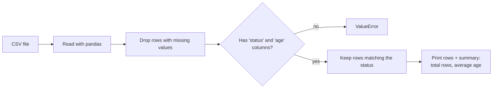

# Python Foundations

A hands-on project for building solid Python fundamentals together with a professional development workflow: typed code, linting and formatting, debugging, tests, environment configuration, and a branch-and-pull-request Git workflow.


> **Type:** learning project. The main deliverable is a small command line tool plus a set of refactoring exercises, documented in a weekly [learning log](learning-log.md).

## Problem Statement

Knowing Python syntax is not the same as writing code that a team can maintain. This project practises the habits around the code: type hints checked by mypy, consistent formatting, linting, debugging with breakpoints instead of `print()`, tests, configuration through environment variables, and small, reviewable Git branches.

## Objectives

- Build a command line tool that reads, validates, filters and summarises CSV data.
- Refactor older scripts with comprehensions, dataclasses, `pathlib` and context managers.
- Use Ruff, Black and mypy (strict mode) as a single quality check.
- Practise the VS Code debugger, custom exceptions and `.env` configuration.
- Work through feature branches and pull requests (see the repository's closed PRs).

## Technologies

| Area | Tools |
|---|---|
| Language | Python 3.12 |
| Command line tool | Typer, pandas |
| Environment and packages | uv (`pyproject.toml` + `uv.lock`), python-dotenv |
| Code quality | Ruff, Black, mypy |
| Testing | pytest |
| Editor and debugging | VS Code, debugpy |

## How the Command Line Tool Works



## Project Structure

```text
python-foundations/
├── src/
│   ├── main.py               # CSV summary command line tool (Typer)
│   ├── comprehensions.py     # list, nested and dictionary comprehensions
│   ├── exceptions.py         # built-in and custom exceptions with a Typer command
│   └── testDebuger.py        # small function used for a VS Code debugging exercise
├── scripts/
│   ├── script1.py            # refactored with comprehensions and a dataclass
│   ├── script2.py            # refactored with pathlib
│   ├── script3.py            # refactored with context managers
│   └── quality.py            # runs Black, Ruff and mypy --strict in one go
├── tests/
│   └── test_main.py          # pytest tests for the command line tool
├── data/user.csv             # sample input
├── learning-log.md           # weekly learning log
├── refactoring-comparison.md # before / after notes for the scripts
├── git-notes.md              # Git commands and pull request workflow
├── .env.example
├── pyproject.toml
└── uv.lock
```

## Installation

Requires [uv](https://docs.astral.sh/uv/). uv installs Python 3.12 automatically (pinned in `.python-version`).

```bash
git clone https://github.com/Re7absu/python-foundations.git
cd python-foundations
uv sync
cp .env.example .env    # optional: local settings
```

## How to Run

Summarise the sample data, keeping only rows whose `status` is `active`:

```bash
uv run python src/main.py data/user.csv active
```

Output:

```text
    name   age  status
0  Rehab  25.0  active
2  Ahmed  28.0  active
        Metric  Value
0   Total Rows    2.0
1  Average Age   26.5
```

Run the tests and the quality checks:

```bash
uv run pytest
uv run python scripts/quality.py   # Black, Ruff, mypy --strict
```

## Features

- CSV validation: the tool stops with a clear error when the `status` or `age` columns are missing.
- Filtering by any status value passed on the command line.
- Summary table with row count and average age.
- One-command quality gate (format, lint, strict type check).
- Documented refactoring with before/after notes.

## What I Learned

The [learning log](learning-log.md) records the details. In short: comprehensions and dataclasses, `pathlib`, context managers, custom exceptions, strict typing, the VS Code debugger, `.env` configuration, and a Git workflow with feature branches, `stash`, `reset --soft`, `revert` and pull requests.

## Future Improvements

- Add tests for the refactored scripts and the custom exception.
- Make the required columns and the summary metrics configurable.
- Add a GitHub Actions workflow that runs the tests and quality checks on every pull request.
